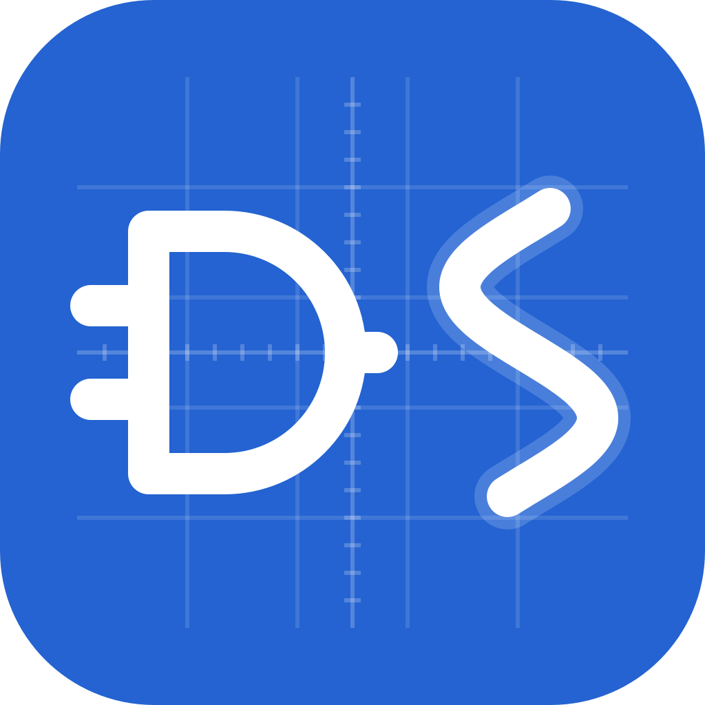

<p align="center">
  
</p>

<p align="center">
  A desktop editor for digital logic schematics, with a text language for writing them as code.
</p>

---

DigiSchem draws digital circuits: gates, flip-flops, registers, multiplexers, adders, memories
and more, wired together on a grid. It is built for lab reports and course work, where a
schematic has to be clear, correct and printable. It is also built for circuits written as text:
you (or a language model) can describe a circuit in **DSpec**, and the compiler places the parts,
routes the wires, tidies the layout and checks that the drawing connects exactly what the text
says.

<p align="center">
  
  <br><em>A 4-bit ripple-carry adder, compiled from <a href="examples/adder4.dspec">examples/adder4.dspec</a>.</em>
</p>

## Features

- **80 components** in 11 categories, all parametric: changing a gate's input count, a MUX's
  select bits or a register's width adds or removes real, individually connectable pins.
- **An editor that keeps connections honest.** Wires snap to pins, moving parts drags their
  wires along, and the stored connections never change by accident. Anywhere the drawing and
  the connections disagree is marked in red and explained.
- **Clean automatic routing.** Wires avoid touching anything they do not connect, and balance
  length, bends and crossings.
- **Compact layout** (Ctrl+Shift+L) tightens a sprawling schematic while keeping it readable:
  parts are pulled together, crowded wires and crossings push back, and the wires are then
  relaxed so they run straight, evenly spaced, and in tidy staircases.
- **DSpec**, a small language for schematics: write the parts and connections, press
  Ctrl+Enter, get a drawing. A command-line compiler is included, and a "Copy guide for AI"
  button prepares everything a language model needs to write DSpec.
- **Logic tools**: an exact boolean minimizer (Karnaugh maps / Quine-McCluskey), a generator that
  draws a minimized function as a two-level AND-OR schematic, and an evaluator that checks a
  drawing against a truth table.
- **Export** to SVG and PNG (color, monochrome for printing, or dark), and to a text netlist.

## Quick start

```sh
git clone https://github.com/themostvexingparse/DigiSchem.git
cd DigiSchem
npm install
npm run dev          # the editor in a browser at http://localhost:1420
npm run tauri dev    # or as a desktop app (needs Rust)
```

Then press **?** in the editor for the keyboard shortcuts, or **Ctrl+K** to write a circuit as
code:

```dspec
@name "Half adder"
part A, B input-pin
part X1 xor
part G1 and
part S, C output-pin

A -> X1.in0, G1.in0
B -> X1.in1, G1.in1
X1 -> S
G1 -> C
```

## Documentation

The full documentation is in the [wiki](https://github.com/themostvexingparse/DigiSchem/wiki)
(the same pages are in [`docs/`](docs/Home.md)):

| Page | What it covers |
|---|---|
| [Getting Started](docs/Getting-Started.md) | Installing, running, building the desktop app |
| [Using the Editor](docs/Using-the-Editor.md) | Tools, wiring, editing, the properties panel, settings, shortcuts |
| [Components](docs/Components.md) | The component library and how parts are configured |
| [DSpec Language](docs/DSpec-Language.md) | Writing schematics as code, the compiler and its command line |
| [Layout and Routing](docs/Layout-and-Routing.md) | How wires are routed, how compaction and wire tidying work |
| [Logic Tools](docs/Logic-Tools.md) | Boolean minimization, generating schematics, checking truth tables |
| [File Format](docs/File-Format.md) | The `.dschem` file, connections, exports |
| [Development](docs/Development.md) | Project structure, architecture, tests, contributing |

## Status

DigiSchem is a drawing tool: it does not simulate circuits (the logic tools can evaluate
combinational drawings). The desktop app is built and tested on Windows; Tauri can also build it
for macOS and Linux. The editor also runs in any modern browser.
