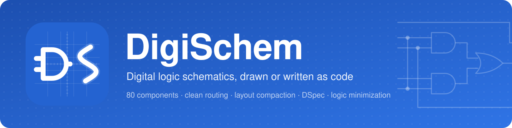
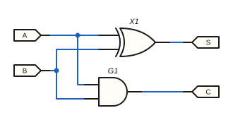
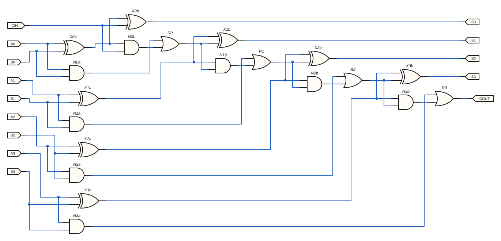

<p align="center">
  
</p>

<p align="center">
  <a href="https://github.com/themostvexingparse/DigiSchem/wiki"><b>Wiki</b></a> ·
  <a href="https://github.com/themostvexingparse/DigiSchem/releases"><b>Download</b></a> ·
  <a href="docs/Getting-Started.md"><b>Getting started</b></a> ·
  <a href="docs/DSpec-Language.md"><b>DSpec language</b></a> ·
  <a href="docs/Components.md"><b>Components</b></a>
</p>

<p align="center">
  <a href="https://github.com/themostvexingparse/DigiSchem/actions/workflows/release.yml"></a>
  
  
  
</p>

**DigiSchem** is a desktop editor for digital logic schematics: gates, flip-flops, registers,
multiplexers, adders, memories and more, wired together on a grid. It is made for lab reports and
course work, where a schematic has to be clear, correct and printable, and for circuits written as
text, by you or by a language model.

## Draw it, or write it

<table>
<tr>
<td width="46%" valign="top">

```dspec
@name "Half adder"
part A, B input-pin
part X1 xor
part G1 and
part S, C output-pin

A -> X1.in0, G1.in0
B -> X1.in1, G1.in1
X1 -> S
G1 -> C
```

</td>
<td width="54%" valign="middle" align="center">
  
</td>
</tr>
</table>

Describe a circuit in **DSpec** (Ctrl+K in the editor) and press Ctrl+Enter: the compiler places
the parts, routes the wires, tidies the layout, and checks that the drawing connects exactly what
the text says. Or draw it by hand with the mouse. Either way it is the same schematic, and
**Read from schematic** turns any drawing back into code.

## Features

<table>
<tr>
<td width="33%" valign="top">

**80 parametric components**<br>
Gates, plexers, arithmetic, latches, flip-flops, registers, counters, memories, displays,
transistors and generic blocks. Changing a property adds or removes real pins.

</td>
<td width="33%" valign="top">

**Connections you can trust**<br>
What connects to what is stored apart from the drawing. Anywhere the two disagree is marked in
red and explained in plain words.

</td>
<td width="33%" valign="top">

**Clean routing**<br>
Wires never touch what they do not connect, and balance length, bends and crossings.

</td>
</tr>
<tr>
<td valign="top">

**Compact layout**<br>
Ctrl+Shift+L tightens a sprawling schematic: parts are pulled together, crowded wires push back,
and wires relax into straight runs and even staircases.

</td>
<td valign="top">

**Logic tools**<br>
Exact boolean minimization with Karnaugh maps, a generator that draws two-level AND-OR circuits,
and a truth-table checker for drawings.

</td>
<td valign="top">

**Export**<br>
SVG and PNG in color, monochrome for printing, or dark; and a text netlist.

</td>
</tr>
</table>

<p align="center">
  
  <br><sub>A 4-bit ripple-carry adder, compiled from <a href="examples/adder4.dspec"><code>examples/adder4.dspec</code></a>.</sub>
</p>

## Get started

**Download** the Windows app from [Releases](https://github.com/themostvexingparse/DigiSchem/releases):
a single `DigiSchem.exe`, or an installer.

**Or run it from source:**

```sh
git clone https://github.com/themostvexingparse/DigiSchem.git
cd DigiSchem
npm install
npm run dev          # in a browser at http://localhost:1420
npm run tauri dev    # as a desktop app (needs Rust)
```

In the editor, press **?** for every keyboard shortcut. The
[Getting Started](docs/Getting-Started.md) page covers building releases and the command-line
compiler.

## Documentation

The [wiki](https://github.com/themostvexingparse/DigiSchem/wiki) has the full documentation. The
same pages are in [`docs/`](docs/Home.md).

| | |
|---|---|
| [Getting Started](docs/Getting-Started.md) | Install, run, build, release |
| [Using the Editor](docs/Using-the-Editor.md) | Tools, wiring, editing, connection checks, settings, shortcuts |
| [Components](docs/Components.md) | The full component library |
| [DSpec Language](docs/DSpec-Language.md) | Schematics as code: syntax, directives, compiler, command line |
| [File Format](docs/File-Format.md) | The `.dschem` file, stored connections, exports |
| [Layout and Routing](docs/Layout-and-Routing.md) | The router, compaction and wire relaxation, with their weights |
| [Logic Tools](docs/Logic-Tools.md) | Minimizer, schematic generator and evaluator APIs |
| [Development](docs/Development.md) | Project structure, architecture rules, tests, contributing |

## Status

DigiSchem draws circuits; it does not simulate them (the logic tools evaluate combinational
drawings). The desktop app is built and tested on Windows; Tauri can also build it for macOS and
Linux, and the editor runs in any modern browser.
