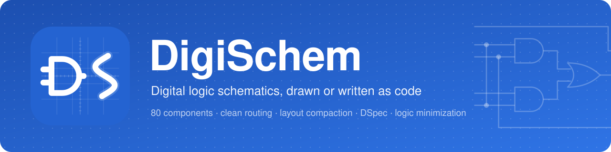
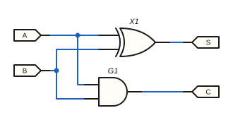
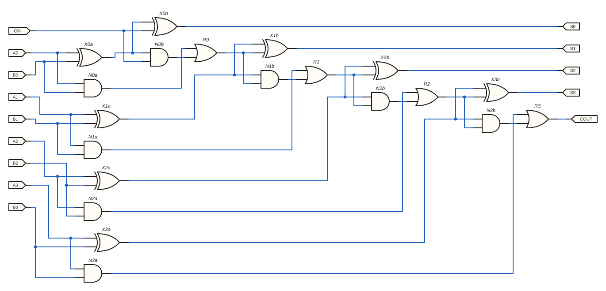

Welcome to the DigiSchem wiki. **DigiSchem** is a desktop editor for digital logic schematics. Its
text language, **DSpec**, lets you (or a language model) write a circuit as code and have it drawn,
routed and checked.

**[Download](https://github.com/themostvexingparse/DigiSchem/releases)** ·
**[Source](https://github.com/themostvexingparse/DigiSchem)** ·
**[Getting Started](Getting-Started.md)**

## Start here

| | |
|---|---|
| **[Getting Started](Getting-Started.md)** | Install, run in a browser or as a desktop app, build a release |
| **[Using the Editor](Using-the-Editor.md)** | Placing parts, wiring, editing, connection checks, settings, every shortcut |
| **[Components](Components.md)** | The 80 parts in the library, and how their pins follow their properties |
| **[DSpec Language](DSpec-Language.md)** | Write a circuit as text; directives, the command line, working with language models |
| **[File Format](File-Format.md)** | What a `.dschem` file contains; SVG, PNG and netlist exports |

## How it works

| | |
|---|---|
| **[Layout and Routing](Layout-and-Routing.md)** | The router's cost model, layout compaction, and wire relaxation |
| **[Logic Tools](Logic-Tools.md)** | Boolean minimization, two-level schematic generation, truth-table checks |
| **[Development](Development.md)** | Project structure, architecture rules, tests, contributing |

## A first circuit

Open the code editor with **Ctrl+K**, paste this, and press **Ctrl+Enter**:

```dspec
@name "Half adder"
part A, B input-pin
part X1 xor
part G1 and
part S, C output-pin

A -> X1.in0, G1.in0
B -> X1.in1, G1.in1
X1 -> S
G1 -> C
```



The compiler places the parts, routes the wires and checks that the drawing connects exactly what
the text says. Larger circuits work the same way:


