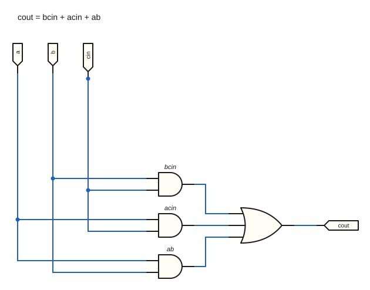

# Logic Tools

`src/logic/` holds three TypeScript modules for combinational logic. They have no dependencies on
the editor, so they can be used from tests, scripts, or new features.

| Module | What it does |
|---|---|
| `minimize.ts` | Exact two-level boolean minimization, with Karnaugh map text |
| `sop-schematic.ts` | Draws a sum of products as a two-level AND-OR schematic |
| `evaluate.ts` | Computes what a combinational drawing outputs, for checking it against a truth table |



## Minimizing a function

```ts
import { minimize, sopToString, kmapText } from "./src/logic/minimize";

// variable 0 is the least significant bit of a minterm
const names = ["cin", "b", "a"];
const r = minimize(3, [3, 5, 6, 7]);         // the carry out of a full adder
sopToString(r.terms, names);                  // "bcin + acin + ab"
```

`minimize(n, minterms, dontCares?)` returns:

| Field | Contents |
|---|---|
| `terms` | The minimal sum of products: fewest terms, then fewest literals |
| `primes` | Every prime implicant (every largest group of 1s and don't cares on the map) |
| `essential` | The primes that are the only cover of some 1 |

A term is `{ value, mask }`: bits set in `mask` are variables left out of the product, and the
other bits of `value` say whether each variable appears plain (1) or complemented (0).

### How it works

This is the Karnaugh map method done mechanically (Quine-McCluskey):

1. **Prime implicants.** Start from the minterms and don't cares. Combine any two terms that
   differ in exactly one variable into a term without that variable, and repeat until nothing
   combines. The terms that never combined are the primes: on a Karnaugh map, the largest
   rectangles of 1s (and don't cares) that fit.
2. **Essential primes.** A 1 covered by only one prime makes that prime essential; it is always
   in the answer.
3. **Cheapest cover.** The remaining 1s are covered with the cheapest set of the remaining primes,
   found exactly by branch and bound (always branching on the 1 with the fewest options).

The result is exact: on all 256 functions of three variables it matches a brute-force search
over every set of terms. It handles up to 16 variables, though the cover search is meant for the
small functions schematics deal with (up to about 8).

### Karnaugh maps

```ts
kmapText(3, (m) => ([3, 5, 6, 7].includes(m) ? 1 : 0), names, r.terms);
```

```
a\bcin |   00   01   11   10
-------+--------------------
0      |    0    0   1A    0
1      |    0   1B 1ABC   1C

  A = bcin
  B = acin
  C = ab
```

The low half of the variables label the columns and the high half the rows, both in Gray-code
order, so neighbouring cells differ in one variable. Each 1 is followed by the letters of the
chosen terms that cover it (the cell a = b = cin = 1 is covered by all three). Cells can also be `"x"` for don't care.

## Drawing a function

```ts
import { sopToSchematic } from "./src/logic/sop-schematic";

const doc = sopToSchematic(r.terms, names, "cout");   // a SchematicDocument
```

The drawing (as in the picture above):

- inputs across the top, most significant first, each dropping a vertical rail;
- a NOT gate beside each rail that is needed complemented, dropping the complement rail;
- one AND gate per product of two or more literals, each input tapping straight off a rail;
- an OR gate if there are two or more products, with the AND outputs reaching it in a staircase
  that never crosses itself;
- the expression as a caption.

Wires are placed exactly rather than routed, so the drawing is the same every time, and it
stores its connections, so it opens in the editor with no conflicts. A function that is always 0
or always 1 becomes a constant.

`sopToDspec(terms, names, out)` in `minimize.ts` produces DSpec source for the same circuit
instead, for the compiler to place and route.

## Checking a drawing

```ts
import { evaluateCombinational } from "./src/logic/evaluate";

evaluateCombinational(doc, { a: true, b: true, cin: false }); // { cout: true }
```

The evaluator reads the drawing's netlist and computes every gate (`and`, `nand`, `or`, `nor`,
`xor`, `xnor`, `not`, `buf`) from the input pins and constants. It returns the value of each
output pin by part id, or `undefined` for an output that depends on something it does not model
(sequential parts, feedback loops, an undriven net). Looping over every input combination checks
a schematic against its truth table.
